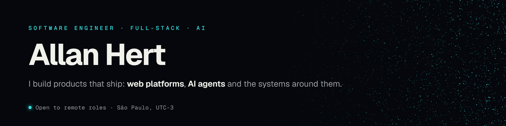
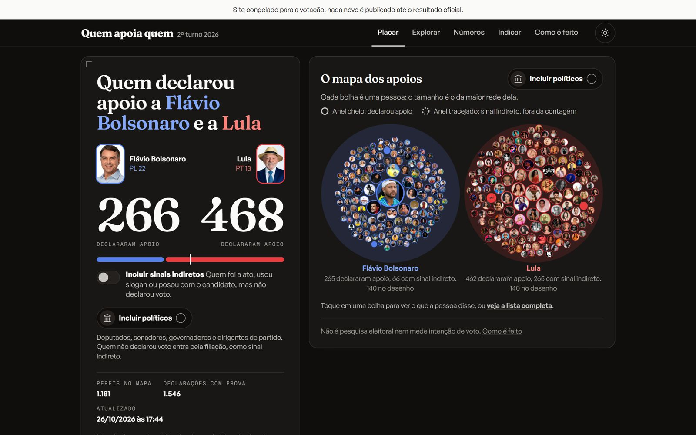

<!-- Generated from profile.yaml by scripts/build_readme.py. Edit profile.yaml, not this file. -->

  <a href="https://allanhert.com">allanhert.com</a>
  ·
  <a href="https://www.linkedin.com/in/allanhert">LinkedIn</a>
  ·
  <a href="https://x.com/HertAllan">X</a>
  ·
  <a href="mailto:allanhert@gmail.com">Email</a>
  ·
  <a href="https://hertwave.com">Hertwave</a>

## About

I build software end to end: the product decision, the architecture, the interface, the deploy and the fix two months later.
Most days that means **TypeScript and Next.js** on the web, **Python** for automation and data, and **LLM agents** wired into real workflows with tests and human checkpoints.

I run [Hertwave](https://hertwave.com), a small studio in São Paulo that ships sites and software for real clients. I'm also finishing a law degree at Mackenzie, which shapes how I scope anything that touches personal data or a contract.

Most of my work lives in private repositories. Below are case studies that explain what each product does, how it is built and what I decided, plus the code I keep public.

---

## Selected products

### quemapoiaquem

  

A neutral public record of who backed whom in Brazil's 2026 presidential runoff, every endorsement linked to its source. Started on 2026-10-05, live the next day, frozen after the vote: 74,000 visits and about 518,000 views on X by 2026-10-25.

**Focus:** Zero to production in one day · AI triage with human review · Neutrality rules enforced in the data model  
**Stack:** Next.js · TypeScript · Postgres (Neon) · Cloudflare R2 · Playwright · Claude

<a href="https://quemapoiaquem.com.br"><strong>Live product →</strong></a> &nbsp;·&nbsp; <a href="https://github.com/AllanHert/quemapoiaquem"><strong>Case study →</strong></a>

### Valor de Imóveis

  

The platform behind a live real-estate agency: public site, admin, watermarked photos, XML feeds to Brazil's major listing portals and a CRM. Built multi-tenant from the schema up, with Postgres row-level security.

**Focus:** Full-stack platform · Portal integrations · Tenant isolation  
**Stack:** Next.js · TypeScript · Supabase / Postgres · Cloudflare R2 · Vercel AI Gateway

<a href="https://valordeimoveis.com.br"><strong>Live product →</strong></a> &nbsp;·&nbsp; <a href="https://github.com/AllanHert/valor-imoveis"><strong>Case study →</strong></a>

---

## AI systems and internal tools

<table>
  <tr>
    <td width="56" align="center"></td>
    <td><a href="https://github.com/AllanHert/jarvis"><strong>Jarvis</strong></a> Local-first voice assistant for Windows: Whisper wake word, local TTS, Claude Code acting on the PC through typed MCP tools that ask for confirmation. Python · Claude Code + MCP · faster-whisper · Tauri + React · Ollama · SQLite</td>
  </tr>
  <tr>
    <td width="56" align="center"></td>
    <td><a href="https://github.com/AllanHert/hertwave-os"><strong>Hertwave OS</strong></a> The studio's agent factory: Claude Code agents build client sites, a critic scores each render on a 9-part rubric and a fix is kept only if the score rises. Claude Code agents · Node.js · Playwright · Next.js · Tailwind v4</td>
  </tr>
  <tr>
    <td width="56" align="center"></td>
    <td><a href="https://github.com/AllanHert/contratos"><strong>Contratos</strong></a> Turns property records and ID scans into full real-estate contracts: 13 types, faithful to the agencies' own templates, with a human check on the deal sheet before the .docx. Python · Claude · JSON Schema · docxtpl</td>
  </tr>
  <tr>
    <td width="56" align="center"></td>
    <td><a href="https://github.com/AllanHert/quant-research"><strong>Quant research</strong></a> Systematic research for crypto and US equities: hypotheses registered before testing, a sealed holdout, a blind reviewer agent and paper trading with no orders. Python · Polars · statsmodels · pytest + Hypothesis · Claude Code agents</td>
  </tr>
</table>

## Sites shipped for clients and the studio

| Site | What it shows |
|---|---|
| [hertwave.com](https://hertwave.com) | Studio site: GLSL hero, 3D carousel in React Three Fiber, PT/EN. |
| [nowimoveis.com](https://nowimoveis.com) | Video-first real estate: each YouTube tour becomes a property page in chapters, scroll drives the playhead. |
| [nowmarketing.com.br](https://nowmarketing.com.br) | Agency site with a 3D opening scored to scroll. |
| [oktal.com.br](https://oktal.com.br) | Tech gadget store built as a studio portfolio piece. |
| [jimmyk.com.br](https://www.jimmyk.com.br) | One-page site for an old-school barbershop, built to drive WhatsApp bookings. |

## Public source

<table>
  <tr>
    <td width="56" align="center"></td>
    <td><a href="https://github.com/AllanHert/allanhert-portfolio"><strong>allanhert-portfolio</strong></a> My site and WebGL lab: GPU reaction-diffusion, SDF raymarching and ordered dithering, each one a hand-written shader. Next.js · Three.js · GLSL · Playwright</td>
  </tr>
</table>

---

## Toolkit

  

**Languages:** TypeScript · JavaScript · Python · SQL · GLSL  
**Web:** React · Next.js · Node.js · Tailwind · Three.js / React Three Fiber  
**Data and infra:** Postgres · Neon · Supabase · Vercel · Linux VPS  
**AI:** Claude Code agents · MCP servers · LLM extraction pipelines · local speech (Whisper, TTS)  
**Quality:** Playwright · pytest · Vitest · axe-core  

## How I work

- Start from the real problem and the person using it, then pick the smallest thing that can go live.
- Write the decision down before the code: each project keeps its plan, phases and decision log in the repo.
- Agents do the heavy lifting, people approve anything irreversible: payments, messages, publishing.
- Test what can break, measure what ships, and keep secrets and personal data out of git.

---

Most client work is private. Case studies describe it without the source.
